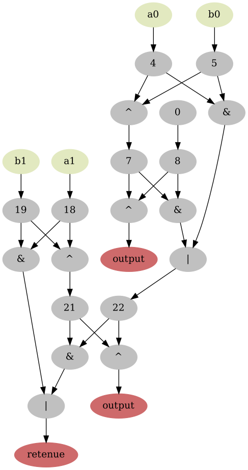
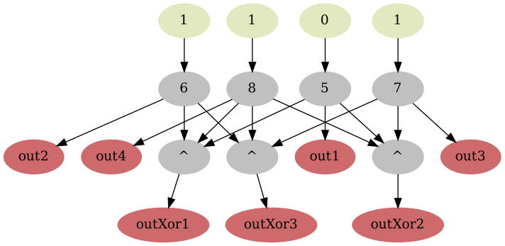

# Graphes orientés et circuits booléens

Bibliothèque Python de graphes orientés ouverts (avec entrées et sorties), utilisée pour construire, composer et évaluer des circuits booléens : additionneurs, code correcteur de Hamming.
Projet informatique de L2 (double licence informatique-mathématiques, Université Paris-Saclay, 2025), réalisé sur un semestre.

La bibliothèque n'utilise que la bibliothèque standard de Python. Elle est couverte par 63 tests unitaires, dont deux vérifications exhaustives : les 256 additions de deux entiers de 4 bits, et la correction d'une erreur sur chacun des 7 bits d'un mot de Hamming, pour les 16 mots possibles.

| Additionneur 2 bits | Encodeur de Hamming (7,4) |
| --- | --- |
|  |  |

## Fonctionnalités

**Graphes (`open_digraph`)**

- Ajout et suppression de nœuds et d'arêtes (avec multiplicité), vérification de la cohérence du graphe (`is_well_formed`).
- Génération aléatoire (graphe libre, sans boucle, acyclique, orienté, non orienté) et conversion vers ou depuis une matrice d'adjacence.
- Composition séquentielle et parallèle de graphes, graphe identité, composantes connexes.
- Algorithme de Dijkstra, plus court chemin, ancêtres communs de deux nœuds.
- Détection de cycle, tri topologique, profondeur, plus long chemin.
- Export et import au format Graphviz (`.dot`), affichage en image ou dans un visualiseur en ligne.

**Circuits booléens (`bool_circ`)**

- Construction d'un circuit à partir de formules propositionnelles, par exemple `((x0)&(x1))|(~(x2))`.
- Génération de circuits aléatoires.
- Additionneurs à propagation de retenue et à anticipation de retenue (carry-lookahead), registres à partir d'un entier.
- Évaluation d'un circuit par réécriture du graphe : les constantes sont propagées porte par porte jusqu'à ce qu'il ne reste que les valeurs de sortie.
- Encodeur et décodeur du code de Hamming (7,4), qui corrige une erreur de transmission.

## Exemple

```python
from modules.open_digraph import open_digraph
from modules.bool_circ import bool_circ

# Graphe : construction, plus court chemin, tri topologique
g = open_digraph.empty()
a, b, c, d = (g.add_node(nom) for nom in "abcd")
g.add_edges([(a, b), (a, c), (b, d), (c, d)])
print(g.shortest_path(a, d))        # [0, 1, 3]
print(g.tri_topologique())          # [{0}, {1, 2}, {3}]
print(g.is_cyclic())                # False

# Circuit booléen : 5 + 11 sur un additionneur 4 bits
additionneur = bool_circ.half_adder(2)
registre = bool_circ.from_int(103, 8)   # bits entrelacés : a3 b3 a2 b2 a1 b1 a0 b0
additionneur.g.icompose_simplifie(registre.g)
additionneur.evaluate()
additionneur.g.display("graphes/addition.dot")   # retenue 1, somme 0000 : 16

# Code de Hamming (7,4) : encodage puis décodage du mot 0111
circuit = bool_circ.composition_encodeur_decodeur("0", "1", "1", "1")
circuit.g.display("graphes/hamming.dot")
```

## Installation et tests

Il faut Python 3.10 ou plus récent. [Graphviz](https://graphviz.org/) n'est nécessaire que pour produire les images (`display`).

Depuis la racine du dépôt :

```bash
python -m unittest discover tests "*_test.py"
```

Plusieurs tests appellent `display` et ouvrent donc des images. Pour générer les fichiers sans ouvrir de fenêtre :

```bash
GRAPHES_SANS_AFFICHAGE=1 python -m unittest discover tests "*_test.py"
```

Les fichiers `.dot` et `.png` produits vont dans le dossier `graphes/`, ignoré par git.

## Organisation du code

```
modules/
  open_digraph.py          classes node et open_digraph
  bool_circ.py             circuits booléens, additionneurs, évaluation, code de Hamming
  digraph_matrix.py        matrices d'adjacence aléatoires
  mixins/
    compositions_mixin.py  ajout et suppression, compositions, composantes connexes
    properties_mixin.py    cohérence, cycles, symétrie
    shortest_path_mixin.py Dijkstra, plus court chemin, ancêtres communs
    longest_path_mixin.py  tri topologique, profondeur, plus long chemin
    matrix_mixin.py        matrice d'adjacence
    display_mixin.py       format .dot et affichage
tests/
  open_digraph_test.py     tests unitaires (unittest)
docs/
  rapport.pdf              rapport du projet
```

La classe `open_digraph` hérite de six mixins, un par famille de fonctionnalités, pour éviter un fichier unique de plusieurs milliers de lignes.

## Corrections apportées après le rendu

Deux erreurs ont été corrigées lors de la reprise du projet pour sa publication. Les tests d'origine ne les détectaient pas, parce qu'ils affichaient les circuits sans vérifier leurs sorties :

- Dans `rewrite`, la règle d'effacement supprimait une porte dès que son fils était une copie, même quand cette copie alimentait encore la suite du circuit. L'évaluation des additionneurs donnait alors des sommes fausses. La règle ne s'applique plus qu'aux copies sans enfant.
- `composition_encodeur_decodeur` transmettait les bits de parité à la place des bits de données.

Les tests exhaustifs cités plus haut ont été ajoutés à cette occasion. Par ailleurs, `evaluate` est désormais silencieuse par défaut (`evaluate(verbose=True)` affiche les étapes), la variable `GRAPHES_SANS_AFFICHAGE` a été ajoutée et le code mort a été retiré.

## Limites connues

- La branche de `rewrite` qui traite les portes NON suivies d'une copie n'est jamais atteinte. L'évaluation n'en a pas besoin quand toutes les entrées sont des constantes, ce qui est le cas des circuits testés.
- Les fonctions d'évaluation modifient le circuit sur place.
- Dijkstra utilise une recherche linéaire du minimum et non un tas.

## Auteurs

Auteur principal: Raphaël Dubach
Collaboration avec Alexis Vo et Théo Gervinet.